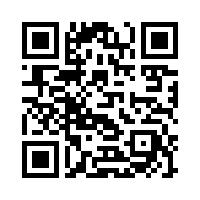

# airgap-wallet

iPhone 双机二维码离线钱包：一台 iPhone 做**离线签名机**（永不联网），一台做**观察钱包**（联网，只有公钥），两机只靠二维码通信。

支持：BTC、DOGE、ETH / BNB Chain / 其他 EVM、SOL、NEAR、TRON（v1.0 目标）。

## 生成与审核

本仓库的全部代码、设计方案、文档与安全审计均由 Anthropic 的 **Claude Fable 5.1** 生成和审核；人类维护者负责提出需求、做产品决策并最终确认。审计报告见 [docs/audit/](docs/audit/)。这不替代独立的人工安全审查，发布前仍须完成 `docs/02-supply-chain-policy.md` 要求的两人审查。

## 原则

- 进入 App 的每一行代码都以**源码**形式存在于本仓库，可追溯到上游 git 的固定 commit。
- 不使用任何预编译库（`.a/.so/.dylib/.dll/xcframework`），不从任何包仓库下载。
- 构建断网、可复现；签名机二进制中不得出现网络代码。
- 没有盲签。解析不完整就拒签。

## 文档

| 文档 | 内容 |
|---|---|
| [docs/00-scope.md](docs/00-scope.md) | 范围、链、不做什么 |
| [docs/01-threat-model.md](docs/01-threat-model.md) | 威胁模型 |
| [docs/02-supply-chain-policy.md](docs/02-supply-chain-policy.md) | 供应链规则（强制） |
| [docs/03-architecture.md](docs/03-architecture.md) | 架构 |
| [docs/04-device-setup.md](docs/04-device-setup.md) | 签名机设备准备流程 |
| [docs/05-decisions.md](docs/05-decisions.md) | 架构决策记录 |
| [docs/feynman/](docs/feynman/) | 每阶段费曼汇报 |

## 状态

开发中，**不要用于真实资金**。

## 打赏

请大哥大姐们打赏一下 Fable 5.1 的 Token 费用。

- **DOGE**：`DJARW5ixK6sfMVGZvHiPNMMzo2Aoki13Cr`（仅发 Dogecoin 网络资产，其他资产将永远丢失）
