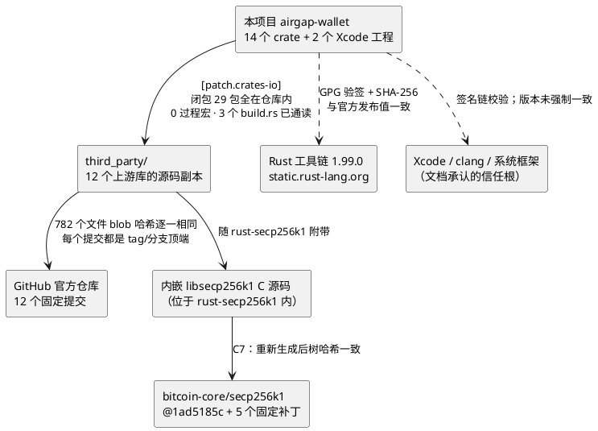

# 安全审计报告：供应链投毒、助记词随机性、功能缺陷

状态：2026-10-10 完成 · 审计对象：`main` 分支提交 `4fd83c9`（文件树与 mac1 上的 `587f7db` 完全一致，仅作者字段不同）· 审计方：Claude（Fable 5.1）与三个独立审查代理 · 审计环境：本机（Apple Silicon，macOS 27，Xcode 27.0，固定工具链 rustc 1.99.0）

> 本报告只陈述核实过的事实。凡写"已确认"均有可复现的命令或复现输入；凡写"需上机验证"均表示只在静态层面成立。审计未修改仓库中任何已跟踪文件。

---

## 0 · 摘要

用户提出三个目标，逐一回答：

| 目标 | 结论 |
|---|---|
| **1. 防止库投毒** | **当前内容：通过。** 整条依赖链的每一环都绕开项目自己的工具独立核对过：12 个第三方库共 782 个文件与 GitHub 上游固定提交逐 blob 相同，且每个提交都是所登记 tag 或分支的顶端；传递闭包 29 个包全部在仓库内、0 个过程宏、3 个 `build.rs` 通读良性；内嵌的 libsecp256k1 与 bitcoin-core 固定提交加固定补丁重新生成后一致；Rust 工具链安装包哈希与 Rust 官方发布值一致。**未来防护：有结构性缺口。** 检查工具自身没有完整性锚，C1 指纹自我指涉，与上游的联网核对只在发布时运行；12 个库的两人人工审查结论目前全部为空。 |
| **2. 防止助记词有规律** | **通过。** 默认混合模式下，32 字节系统随机数全部进入带域分隔的 SHA-256，不存在截断、固定字节、跳过健康检查或回退到软件伪随机数的路径；BIP39 编码与 24 组官方向量逐位一致；60000 条样本的词序号分布卡方值 2047 与 2130（自由度 2047，期望 2047±64），校验和对单词改动的漏检率 6.30% 与 0.44% 与理论值 1/16、1/256 吻合。剩余风险在管线之外：纯骰子模式的质量检查可被近似周期序列绕过，而界面声称能拒绝；截屏无法阻止。 |
| **3. 防止功能有缺陷** | **建议阻止发布。** 152 个测试全部通过，自有代码 clippy 零警告，签名机侧对不可信输入的整数运算全部使用检查算术，没有找到能由二维码内容触发的崩溃，也没有"显示内容 ≠ 签名内容"。但有 1 项严重、2 项高是文档承诺而代码未做到：Safe 多签的 DELEGATECALL 走 EIP-712 `SafeTx` 签名时不会被拒签；未知合约调用数据只显示前 64 字节；BTC 手续费告警阈值与级别弱于文档。另有 14 处文档与代码不一致。 |

总体判断：**供应链与随机性两项合格；功能项有阻断性缺陷，修复前不应用于真实资金**（README 已有同样声明）。

---

## 1 · 方法与环境

- 独立于项目工具的核对：自写脚本从 GitHub 克隆 12 个上游仓库的树对象（不含文件内容），用 `git ls-tree` 得到每个文件的 blob SHA-1，与本地 `third_party/` 逐文件比对；`merge-base --is-ancestor` 验证提交在所登记 ref 的历史中。
- 用 `cargo metadata --offline --locked` 枚举传递闭包，核对每个包的 manifest 路径、`build.rs`、过程宏。
- 通读闭包内全部 3 个 `build.rs`。
- 运行项目自带检查：`tools/checks/run-all.sh --source-only`（C1/C2/C3/C9/C10/C11 + 工具链指纹）、`verify-upstream`、C7、`build-twice.sh`、`build-signer.sh sim`、`build-watcher.sh sim`（含产物检查 C4/C5）。
- 工具链：mac1 上的安装包 → 仓库 `toolchain/PINNED.sha256` → `static.rust-lang.org` 官方 `.sha256`，三方逐一比对；安装目录指纹与 `INSTALLED_TREE.sha256` 一致。
- 测试：`cargo test --workspace --locked --offline`、`cargo clippy --workspace --all-targets`；另写两个临时统计测试（已移出仓库）。
- 三个审查代理分别深读：熵与密钥材料；签名与交易解析；检查工具的可绕过性。代理只读，概率用独立 Python 精确枚举并做蒙特卡洛复核；签名代理在隔离目录建了独立 crate 写了 10 个最小复现，debug 与 release 各跑一遍。
- 环境差异：mac1 的 `TOOLCHAIN.lock` 记录 Xcode 26.6；本机 Xcode 27.0。这一差异在第 5 节被用作跨机器复现的检验条件。

---

## 2 · 防库投毒

### 2.1 依赖链全景

用户担心的链是：本项目 → 开源代码 → 其引用的库 → 再引用的库。实际核对的每一环如下。



### 2.2 逐库核对结果

全部 12 个库按同一套标准核对。"逐文件一致"指本地每个文件的 git blob 哈希与上游固定提交中的同路径文件相同，且没有缺失或多出的文件；"tag/分支顶端"指固定提交恰好等于所登记 ref 指向的提交，排除了取到 fork 网络里同名提交的可能。

| # | 库 | 上游（GitHub） | 固定引用 | 提交 | 顶端 | 文件 | 逐文件一致 | build.rs | 过程宏 | `unsafe` | C 文件 | 进 App | 用途 | 许可证 | 两人审查 |
|---|---|---|---|---|---|---|---|---|---|---|---|---|---|---|---|
| 1 | rust-bitcoin | rust-bitcoin/rust-bitcoin | tag bitcoin-0.32.102 | ff5dc044 | 是 | 244 | 244/244 | 2（仅执行 `rustc --version`） | 0 | 52 | 0 | 是（bitcoin、hashes、io、units、base58） | 比特币类型、PSBT、地址、SHA-256/HASH160 | CC0-1.0 | 未完成 |
| 2 | rust-secp256k1 | rust-bitcoin/rust-secp256k1 | tag secp256k1-0.29.1 | 1a1fc57f | 是 | 216 | 216/216 | 1（用 cc 编译内嵌 C 源码） | 0 | 174 | 107 | 是 | 椭圆曲线签名与恢复 | CC0-1.0（C 库 MIT） | 未完成 |
| 3 | hex-conservative | rust-bitcoin/hex-conservative | tag hex-conservative-0.2.3 | e17b9b2a | 是 | 33 | 33/33 | 0 | 0 | 0 | 0 | 是 | 十六进制编解码 | CC0-1.0 | 未完成 |
| 4 | arrayvec | bluss/arrayvec | tag 0.7.6 | 0aede877 | 是 | 19 | 19/19 | 0 | 0 | 57 | 0 | 是 | 定长数组 | MIT OR Apache-2.0 | 未完成 |
| 5 | rust-bech32 | rust-bitcoin/rust-bech32 | tag v0.11.0 | c2aac494 | 是 | 44 | 44/44 | 0 | 0 | 1 | 0 | 是 | bech32/bech32m 地址 | MIT | 未完成 |
| 6 | cc-rs | rust-lang/cc-rs | tag cc-v1.2.19 | d7d29fc4 | 是 | 84 | 84/84 | 0（闭包内） | 0 | 88 | 20 | 否，仅构建时 | 调用 clang 编译 C | MIT OR Apache-2.0 | 未完成 |
| 7 | shlex | comex/rust-shlex | tag 1.3.0 | 4a0724b0 | 是 | 28 | 28/28 | 0（闭包内；fuzz 目录有一个，不编译） | 0 | 6 | 1（fuzz，不编译） | 否，仅构建时 | 命令行参数转义 | MIT OR Apache-2.0 | 未完成 |
| 8 | python-mnemonic | trezor/python-mnemonic | tag v0.21 | d4b106cd | 是 | 30 | 30/30 | — | — | 0 | 0 | 词表作为数据嵌入；向量仅测试 | BIP39 英文词表与官方向量 | MIT | 未完成 |
| 9 | bc-ur | BlockchainCommons/bc-ur | branch master | 4479fb81 | 是 | 52 | 52/52 | — | — | 0 | 18（不编译） | 否，仅测试比对 | UR 参考实现 | BSD-2-Clause-Patent | 未完成 |
| 10 | bc-research | BlockchainCommons/Research | branch master（7 文件子集） | e4a4fbb1 | 是 | 7 | 7/7 | — | — | 0 | 0 | 否，仅规范文档 | UR / bytewords / hdkey 规范 | BSD-2-Clause-Patent | 未完成 |
| 11 | keccak | RustCrypto/sponges（子目录 keccak） | tag keccak-v0.1.2 | b59a4d5a | 是 | 9 | 9/9 | 0 | 0 | 0 | 0 | 是 | Keccak-f[1600] 置换 | Apache-2.0 OR MIT | 未完成 |
| 12 | ed25519-compact | jedisct1/rust-ed25519-compact | tag 2.4.2 | eb269493 | 是 | 16 | 16/16 | 0 | 0 | 1 | 0 | 是 | Ed25519 签名（SOL/NEAR） | MIT | 未完成 |

补充核对：

- 词表 `english.txt` 的 SHA-256 为 `2f5eed53…dbda`，与 bitcoin/bips 官方一致；运行时 `wordlist::verify()` 重算哈希并检查 2048 个词严格递增。
- 审查记录（`third_party/REVIEW/*.md`）自动标出的可疑位置已逐个核过：rust-bitcoin 的"网络"命中是 P2P 消息序列化结构与 `std::io` 桥接代码，不是联网调用；cc-rs 的"二进制嵌入"是把探测编译器的 C 源码写入临时文件后编译，构建期正常行为；shlex 与 arrayvec 的命中都在不编译的 fuzz 与 tests 目录。
- 项目自带的 `verify-upstream` 对 12 个库全部报告"一致"，与独立核对结论相同。
- 两个按分支固定的库（bc-ur、bc-research）提交仍是 master 顶端；分支可被强推，建议改为 tag 或在 MANIFEST 增加日期标注。

### 2.3 传递依赖闭包

`cargo metadata --offline --locked` 解析结果：29 个包，`Cargo.lock` 29 条，0 个来自 crates.io 或 git，0 个过程宏。14 个为自有 crate，1 个为自写垫片 `hex_lit`，1 个为禁用桩 `bitcoin-consensus-encoding`（只含 `compile_error!`），13 个来自 `third_party/`。声明但未启用的可选依赖（serde、borsh、zeroize、arbitrary、base64、bitcoinconsensus、schemars、core2、jobserver、libc、ct-codecs、ed25519、getrandom、rand）均不在闭包中，因此没有任何随机数库被链进 App。项目的 C3 检查对"全部 feature 组合"也给出同样结论。

### 2.4 构建时代码

闭包内只有 3 个 `build.rs`，全部通读：

| 文件 | 行为 |
|---|---|
| `third_party/rust-bitcoin/bitcoin/build.rs` | 执行 `$RUSTC --version`，按版本输出 `rust_v_1_NN` 编译条件 |
| `third_party/rust-bitcoin/io/build.rs` | 同上 |
| `third_party/rust-secp256k1/secp256k1-sys/build.rs` | 用 `cc` 编译 4 个 C 文件，固定宏定义（ECDH、Schnorr、extrakeys、ellswift、recovery），`printf` 被宏定义为空 |

没有网络、没有写入构建目录之外的路径、没有读取环境做分支（除 `CARGO_CFG_TARGET_ARCH`）。

### 2.5 内嵌 C 库（检查 C7）

`tools/vendor/verify-libsecp256k1.sh` 把上游 revision 与 5 个补丁的哈希固定在脚本内（不从被核对目录读取），从 bitcoin-core/secp256k1 取 `1ad5185c`，验证其在 master 历史中，打补丁并统一改名后重算树哈希。本次运行结果：**通过**。

### 2.6 工具链信任根

| 文件 | mac1 安装包 vs `PINNED.sha256` | `PINNED.sha256` vs Rust 官方 `.sha256` |
|---|---|---|
| channel-rust-1.99.0.toml | 一致 | 一致 |
| rust-1.99.0-aarch64-apple-darwin.tar.xz | 一致 | 一致 |
| rust-std-1.99.0-aarch64-apple-ios.tar.xz | 一致 | 一致 |
| rust-std-1.99.0-aarch64-apple-ios-sim.tar.xz | 一致 | 一致 |

安装目录指纹与 `toolchain/INSTALLED_TREE.sha256` 一致。`rust-std` 的两个 iOS 目标是预编译的标准库，会静态链接进 App；威胁模型已把 Rust 官方编译器列为信任根，这是整个仓库唯一一处进入产物的外部预编译代码。

### 2.7 项目自带检查运行结果

干净树上：C1、C2、C3、C9、C10、C11、工具链指纹全部通过；`verify-upstream`、C7 通过。注意 C2 按文件系统遍历，访达生成的 `.DS_Store` 会使其失败（fail-closed，正确），运行前需清理。

### 2.8 检查工具本身的可绕过性

由独立代理以"攻击者能通过被盗账号提交任意 PR"为模型审查 `tools/` 下全部 1340 行 Python 与各脚本。设计正确的部分：树哈希无歧义（NUL 分隔、含类型与模式）；MANIFEST 解析严格；C2 对白名单内二进制要求路径加哈希双绑定并限定目录、拒绝 gitlink 与嵌套 `.git`；C3 用 `realpath` 比较并枚举全部 feature；C11 按文件系统遍历所有 `.rs` 并与依赖图交叉核对；C4 对产物做原始字节级 `svc` 扫描、dyld 绑定表约束与 `os_log` 格式串约束；沙箱禁网、写入限 `target/`；工具链安装脚本先 GPG 验签（要求 GOODSIG 与指定指纹的 VALIDSIG）再哈希核对再解压。

发现的缺口：

| 严重度 | 缺口 | 位置 | 攻击方式 | 加固建议 |
|---|---|---|---|---|
| 严重 | 检查工具无完整性锚 | `tools/aw.py`、`tools/awlib/*`、`tools/checks/*.allow`、`cargo_checks.py:18` | 同一 PR 同时改被检对象与检查器（如改 `.cargo/config.toml` 并改 `cargo_checks.py` 里固定的哈希），检查自洽通过 | 关键工具文件哈希清单 + 极短的引导检查器；或检查器来自独立受保护仓库 |
| 严重 | C1 指纹自我指涉 | `thirdparty.py:43-44` | 改 `third_party/` 文件并同步改 MANIFEST 的 `tree_sha256`，C1 通过；唯一能绑回上游的 `verify-upstream` 只在 `--release` 运行 | 以 `commit` 为唯一信任锚；CI 对本 PR 改动过的条目联网核对；MANIFEST 指纹变更强制人工复核 |
| 高 | 关键核对只在发布时运行 | `run-all.sh:36-41`、`thirdparty.py:49-52` | 日常分支不联网核对上游、不跑 C7、人工审查未完成只提醒；12 个库审查结论全空 | 对 `third_party`/MANIFEST 的改动强制触发发布级检查；审查结论非空设为合并门槛 |
| 高 | C6 只是单机两路径 | `build-twice.sh:11`、`build-signer.sh:33-43` | 确定性的 `build.rs` 投毒在两路径下结果相同，被当作"已复现" | 要求第二台机器的签名结果；非发布明确标注未独立复现 |
| 高 | C3 环境检查依赖 `env.sh` | `cargo_checks.py:56-61` | 绕开 `env.sh` 单独运行时，`CC`、`SDKROOT`、`DYLD_*`、`CARGO_ENCODED_RUSTFLAGS` 内容不被校验 | C3 改为默认拒绝，并校验 `CARGO_ENCODED_RUSTFLAGS` 等于预期值 |
| 中 | C9 禁用 API 清单遗漏 | `repo_scan.py:112-120` | `NSURLConnection`、`CFSocket`、`getaddrinfo` 等多数被 C4/C5 兜底；`UIActivityViewController`、`FileHandle` 写、`debugPrint`、`dump` 两层都不兜底 | 补齐清单，使 C9 与 C4/C5 重合 |
| 中 | pbxproj 构建设置注入未检查 | `repo_scan.py:118-120`、`build-signer.sh:51-53` | `OTHER_SWIFT_FLAGS=-load-plugin-executable` 可在构建机执行代码；xcodebuild 不在沙箱内 | C9 增加对 `OTHER_*FLAGS`、`-load-plugin*`、`-Xfrontend` 的检查 |
| 中 | 沙箱 `allow default` | `tools/cargo-sb:30,54` | `build.rs` 可读构建机任意文件、执行 `/bin/sh`，仅禁网 | 改 `deny default` 白名单式 |
| 低 | 工具链指纹排除项 | `common.py:22` | `lib/rustlib/manifest-*`、`uninstall.sh` 不计入指纹 | 对排除文件单独登记哈希 |
| 低 | 非发布时 Xcode 只做轻量校验 | `verify-toolchain.sh:16-21` | 完整签名校验只在 `AW_FULL_VERIFY=1` | 发布机始终开启 |

### 2.9 结论

链上每一环的当前内容与上游一致，没有投毒。但"将来有人投毒时自动检查能否抓住"这个问题，答案是日常分支抓不住、发布时才可能抓住，而发布门槛所需的人工审查目前一项都没有完成。

---

## 3 · 助记词随机性

### 3.1 熵的完整路径

Swift `SecRandomCopyBytes` 取 32 字节，检查返回码与全零，失败即抛错不回退（`ios/Signer/Signer/AWCore.swift:38-44`）；指针直接交给 Rust，`defer` 原地清零。Rust 侧 `aw_session_generate`（`core/crates/aw-ffi-signer/src/lib.rs:165-189`）：读取长度写死 32 → `system_health` 四项检查 → 记录带标签的摘要 → `entropy::mixed` 计算 SHA-256("airgap-wallet/entropy/v1" ‖ 系统随机数 ‖ u64 大端骰子个数 ‖ 骰子) → 12 词取前 16 字节、24 词取 32 字节 → `Mnemonic::from_entropy`。写入会话助记词的只有生成与恢复两处，无条件编译分支，无 feature 开关，无启动参数注入点；固定字节只出现在自检与测试。词数只接受 12 与 24，界面也只提供这两项。

纯骰子模式：熵 = SHA-256(ASCII '1'..'6' 串) 的前 16/32 字节，与 Coldcard 做法一致，可用 `shasum -a 256` 独立复算；最少 50/100 次（129/258 位）。

BIP39 编码：校验和位数 ENT/32，从最高位起每 11 位一组，`bit_at` 高位在前；`from_indices` 由序号还原熵再重算比对；`to_seed` 为 PBKDF2-HMAC-SHA512 2048 轮、salt = "mnemonic" ‖ passphrase；NFKD 在 Swift 侧完成。BIP32 根密钥 HMAC-SHA512("Bitcoin seed")，无效值返回错误；SLIP-10 Ed25519 只允许硬化派生。

### 3.2 统计测试

临时测试（已移出仓库）用 SHA-256(计数器) 模拟混合模式输出，各 60000 条：

| 指标 | 12 词 | 24 词 | 理论值 |
|---|---|---|---|
| 全体词序号卡方（自由度 2047） | 2047.0 | 2130.3 | 2047 ± 64，阈值 2367 |
| 各位置最差卡方 | 2172.4 | 2172.4 | 阈值 2367 |
| 每词出现次数 最少/最多/期望 | 288 / 415 / 352 | 616 / 792 / 703 | — |
| 改一个词仍被接受 | 6.30% | 0.44% | 1/16 = 6.25%，1/256 = 0.39% |
| 翻转校验位仍被接受 | 0 | 0 | 0 |
| 重复助记词 | 0 | 0 | 0 |

分布无可测偏差；校验和行为与 BIP39 本身的强度完全一致。

代理独立精确计算的误报率：系统随机数健康检查四项合计约 6.5e-9（每 1.5 亿次误拒一次）；骰子质量三项合计 n=50 约 6.2e-6、n=100 约 9.4e-6，20 万条随机序列 0 次被拒。

### 3.3 发现

| 严重度 | 发现 | 位置 | 说明 |
|---|---|---|---|
| 中 | 骰子质量检查可被近似周期绕过 | `entropy.rs:122-154`；`SetupViews.swift:191` | 只认整串严格周期 ≤12 与连续 ≥10 相同。`123456` 循环中改一位、周期 13/14、圆周率取模均通过；此类串真实熵仅十几至二十几位，可被预先枚举。界面声称"有规律会被拒绝"过头。建议加近似周期检查（期望 + 6σ，误报 ~4e-6），文案改为"只能拦明显规律" |
| 中 | 截屏无法阻止 | `PrivacyShield.swift:33-37`；对照 `docs/01` T10 | 只在截屏后弹窗；备份页截屏即把 24 个词存进相册。录屏/投屏遮罩有效；切换器快照需上机验证。建议把单词放进 `isSecureTextEntry` 图层 |
| 低 | Swift `@State` 清零无效 | `SetupViews.swift:151,180,206-215` | `State` 只有 get/set 无 `_modify`，每次 append/置零都是写时复制，旧缓冲区含完整骰子串未清零即释放；残留是否存在需上机验证 |
| 低 | 单词序号多份副本 | `SetupViews.swift:53,246,266-302`；`AWCore.swift:141-143` | 每次刷新拷贝全部序号为 `[Int]`，不清零 |
| 低 | 无自动锁定与显式清除接口 | `WalletView.swift:34`；`RootView.swift:26-41`；`lib.rs:79-91` | 会话可长期持有助记词或账户扩展私钥；建议后台/超时释放，增加 `aw_session_clear` |
| 低 | 启动自检覆盖缺口 | `selftest.rs:21-29,104-118` | 无 `mixed()`/`dice_only()` 已知答案；BIP39 自检全用全零熵，取位顺序错误也只在校验位暴露；Rust 侧无"自检已通过"标志 |
| 低 | 官方向量缺口 | `aw-keys` | BIP32 向量 1–5 不在本仓库测试中（只在 third_party 内，工作区 exclude）；SLIP-10 只有向量 1 的部分节点；BIP84 未比对 zprv/zpub |
| 低 | NFKD 无端到端测试 | `AWCore.swift:146` | 现在正确；改成 `Array(text.utf8)` 后 152 个测试仍全通过。"Café" 下与 Trezor/Sparrow 种子不同（`47162398…` vs `d17e00ec…`） |
| 低 | 恢复不提醒公开测试助记词 | `SetupViews.swift:295-306` | "abandon × 11 about" 主网照常解锁 |
| 低 | 残留探针盲区 | `tools/probe/stack_scan.c:56-74` | 未走混合模式；不扫 `[u16;24]` 序号形式与 HMAC ipad/opad 中间态；LTO 内联后的栈帧不在擦除范围 |
| 低 | 骰子上限 1024 只在 Rust 侧 | `lib.rs:37`；`SetupViews.swift:180` | 可用性问题 |
| 信息 | 存储模式（D4）与 SeedQR 未实现；`aw_signer.h:2` 写接口版本 3 实际为 4；`last_system` 仅会话内有效 | | |

### 3.4 结论

默认混合模式下生成的助记词不会有规律，前提是 iOS 的 `SecRandomCopyBytes` 可信（威胁模型已列为信任根）。健康检查能拦住全零、卡住、等差与同会话重复，拦不住"看似随机但低熵"的生成器；混合模式不强制骰子，默认流程允许 0 次，因此骰子是用户可选的覆盖而非强制覆盖。

---

## 4 · 功能缺陷

### 4.1 自动化结果

| 项目 | 结果 |
|---|---|
| `cargo test --workspace --locked --offline` | 152 通过，0 失败，0 忽略 |
| `cargo clippy --workspace --all-targets` | 0 错误；26 条警告全部在 `third_party/`（bech32 14、shlex 5、arrayvec 2 等），自有代码 0 条 |
| 整数运算（签名机侧） | 对不可信输入的 + − × 全部使用 `checked_*`/`saturating_*`/u128（PSBT 金额与手续费、RLP/CBOR 长度、UR 分片参数、EIP-712 数组长度、U256、gas×价格、EIP-155 v） |
| 可由二维码触发的 panic | 未找到；`indexing_slicing` 在范围内生产代码 0 条；`split_at`/`copy_from_slice` 均有前置检查；递归深度 RLP 8、CBOR 16、JSON 32 |
| JSON 输出 | 转义 `"`、`\`、控制字符、U+2028/2029；构造不出非法 JSON 的输入 |
| 解析器严格性 | RLP 拒绝非规范编码/前导零/剩余字节；CBOR 只接受最短编码、拒绝不定长；UR 校验 CRC32 两次、分片参数一致性、重复忽略；EIP-7702（type 4）拒签；链 ID 不符、地址不符、指纹不符均拒签 |

### 4.2 发现

| 严重度 | 发现 | 位置 | 复现与后果 | 状态 |
|---|---|---|---|---|
| **严重** | Safe DELEGATECALL 走 EIP-712 不拒签 | `aw-chain-evm/src/typed_known.rs:59-77`、`typed_review.rs:191-201`（`abi.rs:176-182` 只查链上 execTransaction） | `primaryType:"SafeTx"`、`operation:1` → 只落到通用高风险警告，`confirm_danger=1` 即可签。多签真正起授权作用的正是这份签名（Bybit 事件路径）。`docs/01`、D23 的"默认拒签"不成立 | 已确认（复现 R1） |
| **高** | 未知合约调用数据只显示 64 字节 | `aw-chain-evm/src/review.rs:140-144`（第 262、438 行使用） | 392 字节 execTransaction 内嵌 `approve(…, 2^256−1)`，显示"392 字节：0x6a761202…（64 字节）…"，内层无限额授权看不到。T5/D25 承诺"完整显示" | 已确认（R10） |
| **高** | BTC 手续费告警弱于文档 | `aw-chain-btc/src/review.rs:222-227,316-317` | 阈值 10%（文档 5%）、级别 Caution 不需确认、无绝对值、全部转回自己时不检查。付 10,000 sat、费 8,460（84.6%）→ `confirm_danger=0` 直接签 | 已确认（R4） |
| 中 | 找零序号无上限 | `aw-chain-btc/src/lib.rs:139-160`、`review.rs:146-162` | `change_index=2147483647` 显示"已核验"；gap limit 扫描永远看不到 | 已确认（R2） |
| 中 | 找零被换且删掉派生信息时不告警 | `review.rs:145-163` | 两个输出都判为对外付款，警告为空；`docs/01` 写"默认拒签" | 已确认（R3） |
| 中 | 未知合约 `transfer` 零警告 | `aw-chain-evm/src/review.rs:272-291` | 标题"代币转账"，不需确认；approve/transferFrom 有告警唯独 transfer 没有 | 已确认（R6） |
| 中 | 已知代币大额 approve 不需确认 | `review.rs:92-109,131-136` | 只有 ≥2^128 或 >1 万亿枚算无限额；`approve(…, 999999999999 USDT)` 仅 Caution | 已确认（R7） |
| 中 | 观察机 `build_payment` 裸运算 | `aw-chain-btc/src/watch.rs:84,88-90`；`PayView.swift:42`、`Esplora.swift:25` | `fee_rate=u64::MAX`：debug 下 `attempt to multiply with overflow` 并 abort；release 静默回绕，签名机重算后 `NegativeFee` 拒签，不丢钱 | 已确认（R5，两种构建） |
| 中 | SwiftUI 行 id 重复 | `AWCore.swift:346,352`；`WalletView.swift:133,139` | id = label + value，两笔相同输出可能只渲染一行 | 需上机验证 |
| 中 | gas 与转账金额的区分不够显性 | `aw-chain-evm/src/review.rs:449,463`；`ios/Watcher/Watcher/EvmViews.swift:209` | "金额"只来自 `value`、"最高手续费"只来自 gas 字段，来源分离、无串用；合约调用同时带 value 时有"同时转出"警告。但两行使用同一显示样式；没有"总计最多扣除 = 金额 + 最高手续费"行；观察机构造前不核对余额 ≥ 金额 + 最高手续费；手续费无绝对上限，10% 比例只对原生币转账生效 | 已确认 |
| 低 | EVM 无绝对手续费上限 | `review.rs:482-505` | 999 gwei × 3000 万 gas 代币转账显示 29.97 ETH 零告警 | 已确认（R8） |
| 低 | 喷泉码混合分片按条数限上限 | `aw-ur/src/fountain.rs:313-334` | 8192 帧高度分片使解码器常驻约 140 MB 永不完成（拒绝服务） | Mac 已确认 |
| 低 | `decimals` 无上限 | `aw-ffi-watch/src/evm.rs:191-241` → `uint.rs:132-178` | 4e9 → 4 GB 分配或 40 亿次循环；当前 Swift 只传 6/18 | 已确认 |
| 低 | 观察机 finalize 未清 `final_script_sig` | `watch.rs:219-224` | P2WPKH scriptSig 非空交易无效（拒绝服务） | 已确认 |
| 低 | `aw_buf_free` 契约风险 | `aw-ffi-common/src/lib.rs:115-124` | len 传大越界写零；当前 Swift 用法正确 | 已确认 |
| 低 | locktime 告警不看 nSequence；BIP68 不显示 | `review.rs:237-240,250` | | 已确认 |
| 低 | 粉尘阈值统一 294 sat | `lib.rs:24`、`review.rs:228-233` | P2PKH 546、P2TR/P2WSH 330 不告警 | 已确认 |
| 低 | keypath 内部未知键被跳过 | `aw-ur/src/registry.rs:165` | 与 D23 不一致 | 已确认 |
| 低 | 地址值带后缀影响分组核对 | `review.rs:85-90,252-256`；`WalletView.swift:200` | | 已确认 |
| 低 | `Review::to_json` 生产未用、重复键检查 O(n²)、测试网浏览器指向 testnet4 | `review.rs:332-383`；`json_read.rs:132`；`explorer.rs:31-35` | | 已确认 |

### 4.3 测试覆盖缺口

已覆盖：BTC 全流程往返与 6 类拒签、EVM 1559/旧式/personal_sign/EIP-712（Permit、Permit2、Seaport）与 7 类拒签、FFI `confirm_danger` 行为。缺失：BTC 找零重定向且删派生信息、找零序号极大、手续费比例告警（`HighFeeRatio` 零测试）、`NegativeFee`/`AmountOverflow`、P2TR/P2SH 输入、粉尘、locktime；EVM EIP-2930 完全无测试、链 ID 为 0、部署合约、`SafeTx operation=1`、调用数据完整显示；所有解析器无模糊测试；喷泉码洪泛；观察机极端费率。

### 4.4 文档与代码不一致

| # | 文档 | 代码实际 |
|---|---|---|
| 1 | `docs/00:20` BTC 支持 Schnorr/BIP86 | 无 taptweak，P2TR 输入直接拒（`review.rs:105-107`） |
| 2 | `docs/01:41` T7 BTC anti-exfil | 未实现，只有 RFC6979（`sign.rs:5-6,80`） |
| 3 | `docs/01:40` T6 模糊测试、Kani | 仓库无任何 fuzz 目标或 Kani 证明 |
| 4 | `docs/01:54` 手续费 >5% 强警告 | 10%、Caution、无绝对值 |
| 5 | `docs/01:54` 找零不属于本钱包拒签 | 显示为对外付款 |
| 6 | `docs/01:55`、D23 Safe DELEGATECALL 拒签 | 只拦链上调用数据 |
| 7 | T5、D25 完整显示调用数据 | 前 64 字节 |
| 8 | `docs/00:21`、`docs/06` DOGE（P2b 完成） | 只有地址（`doge.rs`）；`docs/06` 表格仍写 P2b = DOGE |
| 9 | T8、`docs/00:35` 白名单、相似地址告警 | 未实现，只有 4 字符分组 |
| 10 | `docs/00:23-25`、`docs/03:68` SOL/NEAR/TRON 签名、Keystone UR | 只有地址；`parse_request` 只认 eth-sign-request 与 psbt |
| 11 | `docs/06` P2a 验收：Keccak 1000 组、go-ethereum 数据、RLPTests 官方向量 | 310 组（断言 ≥300）、手工构造、代表性用例 |
| 12 | `docs/06:25` ed25519-compact 2.6.0 | D26 与 Cargo.toml 为 2.4.2 |
| 13 | D24 观察机显示相同审查结果 | 仅 EVM；BTC 观察机只返回构造摘要 |
| 14 | D23 读取时拒绝未知键 | keypath 内部跳过 |
| 15 | D21 Keccak 海绵约 60 行 | `docs/06` 写约 30 行 |
| 16 | `docs/04` 测试编号 D1–D4 | 与 `docs/05` 决策编号 D1–D4 撞名 |
| 17 | D4 存储模式、SeedQR 加载 | 均未实现 |

---

## 5 · 本机编译与跨机器复现

按项目正式流程在本机（Xcode 27.0）构建模拟器版：

| 步骤 | 结果 |
|---|---|
| 签名机静态库首次构建并与 mac1 的 `c6.sha256` 比对 | **不一致**：本机 `78487616…`，mac1 `53aafe17…` |
| 成员级差异定位 | 归档 379 个成员，仅 4 个不同，全部是 libsecp256k1 的 C 目标文件（`secp256k1.o`、`precomputed_ecmult.o`、`precomputed_ecmult_gen.o`、`lax_der_parsing.o`）；375 个 Rust 成员逐字节相同 |
| 本机 `build-twice.sh` 两路径复现 | 通过，四个静态库哈希与首次构建一致 |
| 观察机 `Watcher.app` | 构建成功，C6 一致，**全部检查通过（含产物）** |
| 签名机 `Signer.app` | xcodebuild 成功；**产物检查 C4/C5 失败关闭** |

C4/C5 失败的全部内容：45 个不在白名单的导入符号（29 个寄存器特化的 Swift ARC 入口如 `swift_release_x19`、14 个 SwiftUI 内部符号如 `LazyState`、1 个标准库、1 个 autolink 强制加载）、`__TEXT` 出现新节 `__swift_as_cont`、多链接 `/usr/lib/swift/libswiftCoreLocation.dylib`。逐一核对：零网络、零文件、零动态加载符号，禁止清单未命中。同一代码在 mac1 的 Xcode 26.6 上以 772 个导入、27 个链接库全部通过。

结论与建议：

- Rust 部分借固定 rustc 实现了真正的跨机器可复现；C 部分与 Swift 部分的可复现性取决于 Xcode 版本。`verify-toolchain.sh` 目前只校验 Xcode 签名，不强制版本等于 `TOOLCHAIN.lock` 记录值，建议加上。
- 白名单与 Xcode 版本绑定是正确的失败关闭行为；升级 Xcode 时必须审查符号与节的差异后再更新白名单，不能直接追加。
- Xcode 27 的 SwiftUI 会自动链入 CoreLocation 覆盖层，签名机并不需要定位能力，建议用 `-Xfrontend -disable-autolink-framework CoreLocation` 或等效方式排除，并把决定记入 `05-decisions.md`。

---

## 6 · 局限与未做

- 没有在真机上运行任何测试；报告中标"需上机验证"的项目（切换器快照、堆残留、SwiftUI 重复 id、iPhone 内存上限）只在静态层面成立。
- 没有执行模糊测试；解析器"不 panic"的结论来自静态审查与 clippy，不是穷举。
- 没有重审 rust-bitcoin 的 PSBT 解码器与 libsecp256k1 内部实现，只核对了它们与上游一致。
- 没有测试与 Keystone、Sparrow 等外部钱包的实际互通。
- 纯骰子模式与 Coldcard 的"12 词取前 128 位"一致性凭记忆判断，建议对照 Coldcard 文档确认。
- 代理在审查期间只运行过只读的 `git status`/`git log`。

---

## 7 · 建议优先级

**P0（修复前不应发布）**——第 1–3 项已修复（见第 8 节），第 4 项待人工完成

1. EIP-712 `SafeTx` 的 `operation=1` 与对 safeTxHash 的 personal_sign 一律拒签。
2. 未知合约调用数据完整显示，或至少完整显示并解析嵌套的 execTransaction。
3. BTC 手续费告警按文档实现：5% 强警告需确认、绝对值上限、全部转回自己时同样检查。
4. 完成 12 个库的两人人工审查并填写 `REVIEW/*.md` 结论（发布门槛）。

**P1**

5. 检查工具加完整性锚；C1 以 `commit` 为信任锚并在 CI 对改动条目联网核对；审查结论设为合并门槛。
6. `[profile.release]` 开启 `overflow-checks`（签名机侧已全用检查算术，开启只增保险）。
7. `verify-toolchain.sh` 强制 Xcode 版本等于 `TOOLCHAIN.lock`；排除 CoreLocation 覆盖层自动链接。
8. 骰子近似周期检查与界面文案；截屏保护改为 `isSecureTextEntry` 图层。
9. 未知合约 `transfer` 加告警；找零序号上限；找零被重定向时告警；已知代币大额 approve 需确认。
10. 观察机 `build_payment` 改为检查算术。
11. EVM 显示增加"总计最多扣除"行，手续费行使用区别于金额的样式；观察机构造前核对余额 ≥ 金额 + 最高手续费；手续费加绝对上限并对代币转账同样做比例告警。

**P2**

12. Swift 侧秘密改为 Rust 侧缓冲区或固定分配手动清零；自动锁定与 `aw_session_clear`。
13. 自检加入 `mixed()`/`dice_only()`/非全零熵已知答案；补 BIP32 向量 1–5、SLIP-10 向量 2、BIP84 zprv/zpub、非 ASCII passphrase 端到端测试。
14. 为 RLP、CBOR、UR、JSON、PSBT 入口加模糊测试目标（兑现 T6 的承诺）。
15. 沙箱改默认拒绝；C9 清单补齐；pbxproj 构建设置检查。
16. 修正第 4.4 节 17 处文档不一致，或把未实现项明确标为"计划中"。

## 8 · 修复记录

| 轮次 | 提交 | 覆盖 |
|---|---|---|
| 第一轮 | `6a754d7` | P0-1 部分：`SafeTx` `operation=1` 拒签；P0-2 部分：顶层 `execTransaction` 显示内层目标与内层调用；P0-3 部分：5% 比例与绝对上限告警 |
| 第二轮 | 本节随附的提交 | 复审发现的缺口：恰好 32 字节的 personal_sign 消息一律拒签（不论能否显示为文字）；对多签自身的 11 个管理调用（含旧版 `changeMasterCopy` / `signMessage`）拒签（新错误码 17）；`SafeTx.data` 与模块入口 `execTransactionFromModule(ReturnData)`（含 `operation = 0`）按与 `execTransaction` 相同的规则审查；编码不规范的执行入口与字段不全的 `SafeTx` 按无法解析拒签；退款参数（`gasPrice` / `gasToken` / `refundReceiver` / `safeTxGas` / `baseGas` 与最多退款）显示并强警告；嵌套执行入口递归展开（深度 ≤ 3，嵌套层以本层目标为多签）；内层 `transferFrom` / `permit` / DAI permit / Permit2 逐项显示；未知调用数据完整显示；BTC "转给自己"按"无对外输出"判定、0 聪对外输出不绕过比例检查、输出总额为 0 时按手续费 100% 处理；两个 FFI crate 的错误码序号由测试固定；`cargo fmt --all --check` 纳入 `tools/checks/run-all.sh` |

第二轮实现先经独立复审（2 项 HIGH：编码不规范的执行入口退化为"未知调用"、可打印的 32 字节消息无告警；3 项 MEDIUM：模块入口 `operation = 0` 未审查、`baseGas` 放大器未显示、内层调用识别不全；以及测试缺口），全部按复审意见改完并补了对应用例，上表为改完后的状态。第二轮之后，P0 中仍未关闭的只剩第 4 项（12 个库的两人人工审查）——这是人工门槛，代码无法替它关闭。两轮的规则定稿见 `docs/05-decisions.md` D32、D33；明确未覆盖的 Safe 路径（4337 `SafeOp`、EIP-1271、其他模块入口、`SafeMessage`）也记录在 D33。

---

## 附录 A · 关键哈希

| 对象 | SHA-256 |
|---|---|
| `libaw_signer.a`（aarch64-apple-ios-sim，本机三次构建一致） | `78487616ac2e4ec7bfa18d68cf1f17c8d9ab00be28c664d62774c4856c0ed007` |
| `libaw_watch.a`（aarch64-apple-ios-sim，本机） | `52fff9e57cc78dfa936d2e50823b95b191f863c0e0f4a24c8076482d92541339` |
| `libaw_signer.a`（aarch64-apple-ios，本机） | `33c279f26155e9b4cb48df3502ca3d6472cba700896e027d61a24fbca7492f6c` |
| `libaw_watch.a`（aarch64-apple-ios，本机） | `d36ad38611fffa4e3f3a9addd797bb7a16868f41745c902156d5089fae4d16ac` |
| `libaw_signer.a`（aarch64-apple-ios-sim，mac1） | `53aafe177914708fc7c529395232b254096356b0a9c2ab9d954dc42ded585259` |
| BIP39 `english.txt` | `2f5eed53a4727b4bf8880d8f3f199efc90e58503646d9ff8eff3a2ed3b24dbda` |
| 工具链安装目录指纹 | `f7dd72c1a0be43bc71d85ad0f815e395c0e9cb3d6b5dd617313c6f3d068c5ddd` |

## 附录 B · 运行过的命令

```
python3 -I verify_upstream.py            # 独立上游比对（审计方脚本，不在仓库内）
cargo metadata --offline --locked         # 传递闭包
bash tools/checks/run-all.sh --source-only
python3 -I tools/aw.py verify-upstream
bash tools/vendor/verify-libsecp256k1.sh
bash tools/bootstrap/verify-toolchain.sh
cargo test --workspace --locked --offline --no-fail-fast
cargo clippy --workspace --all-targets --locked --offline
cargo test -p aw-bip39 --test audit_checksum   # 临时统计测试，已移出仓库
bash tools/repro/build-twice.sh
bash tools/ios/build-signer.sh sim
bash tools/ios/build-watcher.sh sim
```
