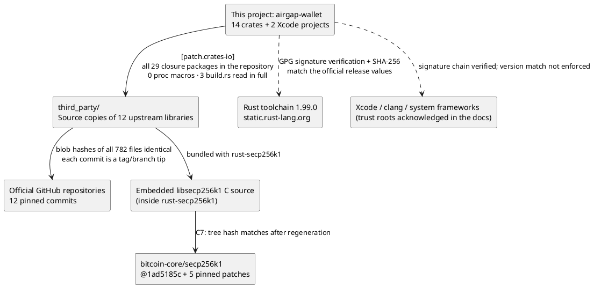

> English translation of docs/audit/2026-10-10-security-audit.md. The Chinese original is authoritative.

# Security Audit Report: Supply Chain Poisoning, Mnemonic Randomness, Functional Defects

Status: completed 2026-10-10 · Audit target: commit `4fd83c9` on the `main` branch (its file tree is identical to `587f7db` on mac1; only the author field differs) · Auditors: Claude (Fable 5.1) and three independent review agents · Audit environment: this machine (Apple Silicon, macOS 27, Xcode 27.0, pinned toolchain rustc 1.99.0)

> This report states only verified facts. Every item marked "confirmed" is backed by a reproducible command or reproduction input; every item marked "needs on-device verification" holds only at the static level. The audit did not modify any tracked file in the repository.

---

## 0 · Summary

The user set three goals; each is answered in turn:

| Goal | Conclusion |
|---|---|
| **1. Prevent library poisoning** | **Current content: pass.** Every link in the dependency chain was verified independently, bypassing the project's own tools: all 782 files of the 12 third-party libraries are blob-for-blob identical to the pinned upstream commits on GitHub, and every commit is the tip of its registered tag or branch; all 29 packages in the transitive closure are inside the repository, there are 0 proc macros, and the 3 `build.rs` files were read in full and are benign; the embedded libsecp256k1 matches the result of regenerating it from the pinned bitcoin-core commit plus the pinned patches; the hashes of the Rust toolchain installers match the values officially published by Rust. **Future protection: structural gaps.** The check tools themselves have no integrity anchor, the C1 fingerprint is self-referential, and online verification against upstream runs only at release time; the two-person human review verdicts for all 12 libraries are currently empty. |
| **2. Prevent patterned mnemonics** | **Pass.** In the default mixed mode, all 32 bytes of system random data go into a domain-separated SHA-256; there is no path that truncates, uses fixed bytes, skips the health check, or falls back to a software pseudo-random number generator; the BIP39 encoding matches 24 sets of official test vectors bit for bit; across 60000 samples, the chi-square values of the word-index distribution are 2047 and 2130 (2047 degrees of freedom, expected 2047±64), and the checksum's miss rates for single-word changes, 6.30% and 0.44%, agree with the theoretical values of 1/16 and 1/256. The remaining risks lie outside the pipeline: the quality check in dice-only mode can be bypassed with near-periodic sequences, even though the UI claims they will be rejected; screenshots cannot be prevented. |
| **3. Prevent functional defects** | **Recommendation: block release.** All 152 tests pass, the project's own code has zero clippy warnings, all integer arithmetic on untrusted input on the Signer side uses checked arithmetic, no crash triggerable by QR code content was found, and there is no case of "displayed content ≠ signed content". However, 1 Critical and 2 High items are promises made in the documentation that the code does not keep: a Safe multisig DELEGATECALL is not refused when it is signed via EIP-712 `SafeTx`; only the first 64 bytes of unknown-contract calldata are displayed; the threshold and level of the BTC fee warning are weaker than documented. There are also 14 further inconsistencies between documentation and code. |

Overall assessment: **supply chain and randomness both pass; functionality has blocking defects, and the wallet should not be used with real funds until they are fixed** (the README already makes the same statement).

---

## 1 · Method and environment

- Verification independent of the project's tools: a self-written script cloned the tree objects of the 12 upstream repositories from GitHub (without file contents), used `git ls-tree` to obtain the blob SHA-1 of every file, and compared them file by file with the local `third_party/`; `merge-base --is-ancestor` verified that each commit is in the history of its registered ref.
- Enumerated the transitive closure with `cargo metadata --offline --locked`, and checked each package's manifest path, `build.rs`, and proc macros.
- Read all 3 `build.rs` files in the closure in full.
- Ran the project's own checks: `tools/checks/run-all.sh --source-only` (C1/C2/C3/C9/C10/C11 + toolchain fingerprint), `verify-upstream`, C7, `build-twice.sh`, `build-signer.sh sim`, `build-watcher.sh sim` (including artifact checks C4/C5).
- Toolchain: installers on mac1 → `toolchain/PINNED.sha256` in the repository → the official `.sha256` files on `static.rust-lang.org`, compared one by one across all three; the install-directory fingerprint matches `INSTALLED_TREE.sha256`.
- Tests: `cargo test --workspace --locked --offline`, `cargo clippy --workspace --all-targets`; in addition, two temporary statistical tests were written (since moved out of the repository).
- The three review agents each did an in-depth reading of one area: entropy and key material; signing and transaction parsing; bypassability of the check tools. The agents were read-only; probabilities were computed by exact enumeration in independent Python and cross-checked by Monte Carlo simulation; the signing-review agent created a standalone crate in an isolated directory and wrote 10 minimal reproductions, running each once in debug and once in release.
- Environment difference: the `TOOLCHAIN.lock` on mac1 records Xcode 26.6; this machine has Xcode 27.0. Section 5 uses this difference as a test condition for cross-machine reproduction.

---

## 2 · Preventing library poisoning

### 2.1 Dependency chain overview

The chain the user is concerned about is: this project → open-source code → the libraries it references → the libraries those reference in turn. Each link that was actually verified is shown below.



### 2.2 Per-library verification results

All 12 libraries were verified against the same criteria. "Identical file by file" means that the git blob hash of every local file is identical to that of the file at the same path in the pinned upstream commit, with no missing or extra files; "tag/branch tip" means that the pinned commit is exactly the commit that the registered ref points to, which rules out picking up a same-named commit from the fork network.

| # | Library | Upstream (GitHub) | Pinned ref | Commit | Tip | Files | Identical file by file | build.rs | Proc macros | `unsafe` | C files | In the App | Purpose | License | Two-person review |
|---|---|---|---|---|---|---|---|---|---|---|---|---|---|---|---|
| 1 | rust-bitcoin | rust-bitcoin/rust-bitcoin | tag bitcoin-0.32.102 | ff5dc044 | Yes | 244 | 244/244 | 2 (only run `rustc --version`) | 0 | 52 | 0 | Yes (bitcoin, hashes, io, units, base58) | Bitcoin types, PSBT, addresses, SHA-256/HASH160 | CC0-1.0 | Not completed |
| 2 | rust-secp256k1 | rust-bitcoin/rust-secp256k1 | tag secp256k1-0.29.1 | 1a1fc57f | Yes | 216 | 216/216 | 1 (compiles the embedded C source with cc) | 0 | 174 | 107 | Yes | Elliptic-curve signing and recovery | CC0-1.0 (C library MIT) | Not completed |
| 3 | hex-conservative | rust-bitcoin/hex-conservative | tag hex-conservative-0.2.3 | e17b9b2a | Yes | 33 | 33/33 | 0 | 0 | 0 | 0 | Yes | Hexadecimal encoding and decoding | CC0-1.0 | Not completed |
| 4 | arrayvec | bluss/arrayvec | tag 0.7.6 | 0aede877 | Yes | 19 | 19/19 | 0 | 0 | 57 | 0 | Yes | Fixed-length arrays | MIT OR Apache-2.0 | Not completed |
| 5 | rust-bech32 | rust-bitcoin/rust-bech32 | tag v0.11.0 | c2aac494 | Yes | 44 | 44/44 | 0 | 0 | 1 | 0 | Yes | bech32/bech32m addresses | MIT | Not completed |
| 6 | cc-rs | rust-lang/cc-rs | tag cc-v1.2.19 | d7d29fc4 | Yes | 84 | 84/84 | 0 (within the closure) | 0 | 88 | 20 | No, build time only | Invokes clang to compile C | MIT OR Apache-2.0 | Not completed |
| 7 | shlex | comex/rust-shlex | tag 1.3.0 | 4a0724b0 | Yes | 28 | 28/28 | 0 (within the closure; there is one in the fuzz directory, not compiled) | 0 | 6 | 1 (fuzz, not compiled) | No, build time only | Command-line argument escaping | MIT OR Apache-2.0 | Not completed |
| 8 | python-mnemonic | trezor/python-mnemonic | tag v0.21 | d4b106cd | Yes | 30 | 30/30 | — | — | 0 | 0 | Wordlist embedded as data; vectors used only in tests | BIP39 English wordlist and official test vectors | MIT | Not completed |
| 9 | bc-ur | BlockchainCommons/bc-ur | branch master | 4479fb81 | Yes | 52 | 52/52 | — | — | 0 | 18 (not compiled) | No, test comparison only | UR reference implementation | BSD-2-Clause-Patent | Not completed |
| 10 | bc-research | BlockchainCommons/Research | branch master (7-file subset) | e4a4fbb1 | Yes | 7 | 7/7 | — | — | 0 | 0 | No, specification documents only | UR / bytewords / hdkey specifications | BSD-2-Clause-Patent | Not completed |
| 11 | keccak | RustCrypto/sponges (subdirectory keccak) | tag keccak-v0.1.2 | b59a4d5a | Yes | 9 | 9/9 | 0 | 0 | 0 | 0 | Yes | Keccak-f[1600] permutation | Apache-2.0 OR MIT | Not completed |
| 12 | ed25519-compact | jedisct1/rust-ed25519-compact | tag 2.4.2 | eb269493 | Yes | 16 | 16/16 | 0 | 0 | 1 | 0 | Yes | Ed25519 signatures (SOL/NEAR) | MIT | Not completed |

Supplementary checks:

- The SHA-256 of the wordlist `english.txt` is `2f5eed53…dbda`, matching the official bitcoin/bips copy; at runtime, `wordlist::verify()` recomputes the hash and checks that the 2048 words are in strictly increasing order.
- The suspicious locations flagged automatically in the review records (`third_party/REVIEW/*.md`) were checked one by one: the "network" hits in rust-bitcoin are P2P message serialization structures and `std::io` bridging code, not network calls; the "binary embedding" in cc-rs writes the C source used to probe the compiler into a temporary file and then compiles it, which is normal build-time behavior; the hits in shlex and arrayvec are all in the fuzz and tests directories, which are not compiled.
- The project's own `verify-upstream` reports "identical" for all 12 libraries, the same conclusion as the independent verification.
- For the two libraries pinned by branch (bc-ur, bc-research), the commits are still the tip of master; branches can be force-pushed, so it is recommended to switch to tags or add a date annotation in MANIFEST.

### 2.3 Transitive dependency closure

Result of resolving with `cargo metadata --offline --locked`: 29 packages, 29 entries in `Cargo.lock`, 0 from crates.io or git, 0 proc macros. 14 are the project's own crates, 1 is the self-written shim `hex_lit`, 1 is the disabled stub `bitcoin-consensus-encoding` (containing only `compile_error!`), and 13 come from `third_party/`. None of the optional dependencies that are declared but not enabled (serde, borsh, zeroize, arbitrary, base64, bitcoinconsensus, schemars, core2, jobserver, libc, ct-codecs, ed25519, getrandom, rand) is in the closure, so no random number library of any kind is linked into the App. The project's C3 check reaches the same conclusion for "all feature combinations".

### 2.4 Build-time code

There are only 3 `build.rs` files in the closure, all of them read in full:

| File | Behavior |
|---|---|
| `third_party/rust-bitcoin/bitcoin/build.rs` | Runs `$RUSTC --version` and, depending on the version, emits `rust_v_1_NN` compilation conditions |
| `third_party/rust-bitcoin/io/build.rs` | Same as above |
| `third_party/rust-secp256k1/secp256k1-sys/build.rs` | Compiles 4 C files with `cc`, with fixed macro definitions (ECDH, Schnorr, extrakeys, ellswift, recovery); `printf` is macro-defined to nothing |

No network access, no writes to paths outside the build directory, and no branching based on the environment (except `CARGO_CFG_TARGET_ARCH`).

### 2.5 Embedded C library (check C7)

`tools/vendor/verify-libsecp256k1.sh` pins the upstream revision and the hashes of the 5 patches inside the script (rather than reading them from the directory being verified), fetches `1ad5185c` from bitcoin-core/secp256k1, verifies that it is in the history of master, applies the patches and the uniform renaming, and then recomputes the tree hash. Result of this run: **pass**.

### 2.6 Toolchain trust root

| File | mac1 installer vs `PINNED.sha256` | `PINNED.sha256` vs official Rust `.sha256` |
|---|---|---|
| channel-rust-1.99.0.toml | Match | Match |
| rust-1.99.0-aarch64-apple-darwin.tar.xz | Match | Match |
| rust-std-1.99.0-aarch64-apple-ios.tar.xz | Match | Match |
| rust-std-1.99.0-aarch64-apple-ios-sim.tar.xz | Match | Match |

The install-directory fingerprint matches `toolchain/INSTALLED_TREE.sha256`. The two iOS targets of `rust-std` are precompiled standard libraries that are statically linked into the App; the threat model already lists the official Rust compiler as a trust root, and this is the only external precompiled code in the entire repository that ends up in the artifacts.

### 2.7 Results of the project's own checks

On a clean tree: C1, C2, C3, C9, C10, C11, and the toolchain fingerprint all pass; `verify-upstream` and C7 pass. Note that C2 walks the file system, so a `.DS_Store` created by Finder makes it fail (fail-closed, which is correct); clean these up before running it.

### 2.8 Bypassability of the check tools themselves

An independent agent reviewed all 1340 lines of Python and all scripts under `tools/`, using the attacker model "an attacker can submit arbitrary PRs through a stolen account". Parts that are designed correctly: tree hashes are unambiguous (NUL-separated, including type and mode); MANIFEST parsing is strict; for binaries on the allowlist, C2 requires a double binding of path plus hash, restricts them to specific directories, and rejects gitlinks and nested `.git`; C3 compares paths with `realpath` and enumerates all features; C11 walks the file system for all `.rs` files and cross-checks them against the dependency graph; C4 performs a raw-byte-level `svc` scan of the artifacts and enforces dyld binding-table constraints and `os_log` format-string constraints; the sandbox forbids network access and restricts writes to `target/`; the toolchain installation script first verifies the GPG signature (requiring GOODSIG and VALIDSIG with the specified fingerprint), then checks the hashes, and only then extracts.

Gaps found:

| Severity | Gap | Location | Attack method | Hardening recommendation |
|---|---|---|---|---|
| Critical | The check tools have no integrity anchor | `tools/aw.py`, `tools/awlib/*`, `tools/checks/*.allow`, `cargo_checks.py:18` | A single PR changes both the object being checked and the checker (e.g. changes `.cargo/config.toml` together with the hash pinned in `cargo_checks.py`), and the checks pass self-consistently | A hash list of the key tool files + a very short bootstrap checker; or a checker taken from a separate, protected repository |
| Critical | The C1 fingerprint is self-referential | `thirdparty.py:43-44` | Change files in `third_party/` and update `tree_sha256` in MANIFEST to match, and C1 passes; `verify-upstream`, the only check that binds back to upstream, runs only with `--release` | Use `commit` as the sole trust anchor; CI verifies online the entries changed by the PR; changes to MANIFEST fingerprints force a human re-review |
| High | Key verifications run only at release time | `run-all.sh:36-41`, `thirdparty.py:49-52` | Day-to-day branches do not verify against upstream online, do not run C7, and only warn when human review is incomplete; the review verdicts for all 12 libraries are empty | Changes to `third_party`/MANIFEST force release-level checks; make non-empty review verdicts a merge gate |
| High | C6 is only single-machine two-path | `build-twice.sh:11`, `build-signer.sh:33-43` | Deterministic `build.rs` poisoning yields the same result under both paths and is counted as "reproduced" | Require a signed result from a second machine; explicitly mark non-release builds as not independently reproduced |
| High | The C3 environment check depends on `env.sh` | `cargo_checks.py:56-61` | When run on its own, bypassing `env.sh`, the contents of `CC`, `SDKROOT`, `DYLD_*`, and `CARGO_ENCODED_RUSTFLAGS` are not validated | Change C3 to deny by default, and verify that `CARGO_ENCODED_RUSTFLAGS` equals the expected value |
| Medium | Omissions in the C9 forbidden-API list | `repo_scan.py:112-120` | `NSURLConnection`, `CFSocket`, `getaddrinfo`, and the like are mostly backstopped by C4/C5; `UIActivityViewController`, `FileHandle` writes, `debugPrint`, and `dump` are backstopped by neither layer | Complete the list so that C9 overlaps with C4/C5 |
| Medium | Build-setting injection via pbxproj is not checked | `repo_scan.py:118-120`, `build-signer.sh:51-53` | `OTHER_SWIFT_FLAGS=-load-plugin-executable` can execute code on the build machine; xcodebuild does not run inside the sandbox | Add C9 checks for `OTHER_*FLAGS`, `-load-plugin*`, and `-Xfrontend` |
| Medium | The sandbox uses `allow default` | `tools/cargo-sb:30,54` | `build.rs` can read any file on the build machine and execute `/bin/sh`; only network access is forbidden | Switch to `deny default`, allowlist style |
| Low | Exclusions from the toolchain fingerprint | `common.py:22` | `lib/rustlib/manifest-*` and `uninstall.sh` are not included in the fingerprint | Register hashes for the excluded files separately |
| Low | Only lightweight Xcode verification outside releases | `verify-toolchain.sh:16-21` | Full signature verification happens only with `AW_FULL_VERIFY=1` | Always enable it on the release machine |

### 2.9 Conclusion

The current content of every link in the chain is identical to upstream; there is no poisoning. But to the question "if someone poisons it in the future, will the automated checks catch it?", the answer is: not on day-to-day branches, and possibly only at release time — and not a single one of the human reviews required by the release gate has been completed so far.

---

## 3 · Mnemonic randomness

### 3.1 The complete path of entropy

Swift's `SecRandomCopyBytes` obtains 32 bytes, the return code is checked and so is the all-zero case, and on failure an error is thrown with no fallback (`ios/Signer/Signer/AWCore.swift:38-44`); the pointer is handed directly to Rust, and a `defer` zeroizes the buffer in place. On the Rust side, `aw_session_generate` (`core/crates/aw-ffi-signer/src/lib.rs:165-189`): the read length is hard-coded to 32 → the four `system_health` checks → a tagged digest is recorded → `entropy::mixed` computes SHA-256("airgap-wallet/entropy/v1" ‖ system random bytes ‖ u64 big-endian dice count ‖ dice) → 12 words take the first 16 bytes, 24 words take 32 bytes → `Mnemonic::from_entropy`. Only two places write the session mnemonic, generation and recovery; there are no conditional-compilation branches, no feature toggles, and no injection points via launch arguments; fixed bytes appear only in the self-test and in tests. Only 12 and 24 are accepted as word counts, and the UI offers only these two options.

Dice-only mode: entropy = the first 16/32 bytes of SHA-256(string of ASCII '1'..'6'), consistent with Coldcard's approach, and independently recomputable with `shasum -a 256`; at least 50/100 rolls (129/258 bits).

BIP39 encoding: the checksum is ENT/32 bits; the bits are split into groups of 11 starting from the most significant bit, and `bit_at` is most-significant-bit first; `from_indices` reconstructs the entropy from the indices and then recomputes and compares; `to_seed` is PBKDF2-HMAC-SHA512 with 2048 rounds and salt = "mnemonic" ‖ passphrase; NFKD is performed on the Swift side. The BIP32 root key is HMAC-SHA512("Bitcoin seed"), and invalid values return an error; SLIP-10 Ed25519 allows only hardened derivation.

### 3.2 Statistical tests

The temporary tests (since moved out of the repository) simulate mixed-mode output with SHA-256(counter), 60000 samples each:

| Metric | 12 words | 24 words | Theoretical value |
|---|---|---|---|
| Chi-square of all word indices (2047 degrees of freedom) | 2047.0 | 2130.3 | 2047 ± 64, threshold 2367 |
| Worst chi-square across positions | 2172.4 | 2172.4 | Threshold 2367 |
| Occurrences per word, min/max/expected | 288 / 415 / 352 | 616 / 792 / 703 | — |
| Still accepted after changing one word | 6.30% | 0.44% | 1/16 = 6.25%, 1/256 = 0.39% |
| Still accepted after flipping a checksum bit | 0 | 0 | 0 |
| Duplicate mnemonics | 0 | 0 | 0 |

The distribution shows no measurable bias; the checksum behavior is fully consistent with the strength of BIP39 itself.

False-positive rates computed exactly and independently by the agent: the four system-randomness health checks combined, about 6.5e-9 (one false rejection per 150 million runs); the three dice-quality checks combined, about 6.2e-6 at n=50 and about 9.4e-6 at n=100, with 0 rejections across 200,000 random sequences.

### 3.3 Findings

| Severity | Finding | Location | Description |
|---|---|---|---|
| Medium | The dice quality check can be bypassed with near-periodic input | `entropy.rs:122-154`; `SetupViews.swift:191` | It recognizes only a strict whole-string period ≤12 and ≥10 consecutive identical rolls. A `123456` cycle with one position changed, periods 13/14, and a modular reduction of the digits of pi all pass; the real entropy of such strings is only a dozen-odd to twenty-odd bits, and they can be enumerated in advance. The UI's claim that "patterns will be rejected" goes too far. Recommend adding a near-periodicity check (expected + 6σ, false positives ~4e-6) and changing the wording to "only obvious patterns can be blocked" |
| Medium | Screenshots cannot be prevented | `PrivacyShield.swift:33-37`; cf. `docs/en/01` T10 | An alert is shown only after the screenshot has been taken; a screenshot of the backup page saves all 24 words to the photo album. The screen recording/mirroring mask is effective; the app switcher snapshot needs on-device verification. Recommend putting the words in an `isSecureTextEntry` layer |
| Low | Zeroizing Swift `@State` is ineffective | `SetupViews.swift:151,180,206-215` | `State` has only get/set and no `_modify`, so every append/zeroing is a copy-on-write, and the old buffer, which contains the full dice string, is freed without being zeroized; whether residue actually remains needs on-device verification |
| Low | Multiple copies of word indices | `SetupViews.swift:53,246,266-302`; `AWCore.swift:141-143` | Every refresh copies all the indices into an `[Int]`, which is not zeroized |
| Low | No auto-lock and no explicit clear interface | `WalletView.swift:34`; `RootView.swift:26-41`; `lib.rs:79-91` | A session can hold the mnemonic or account extended private keys for a long time; recommend releasing them on backgrounding/timeout and adding `aw_session_clear` |
| Low | Coverage gaps in the startup self-test | `selftest.rs:21-29,104-118` | No known-answer tests for `mixed()`/`dice_only()`; the BIP39 self-test uses only all-zero entropy, so an error in the bit-extraction order would surface only in the checksum bits; the Rust side has no "self-test passed" flag |
| Low | Gaps in official test vectors | `aw-keys` | BIP32 vectors 1–5 are not in this repository's tests (they exist only inside third_party, which the workspace excludes); SLIP-10 has only some nodes of vector 1; BIP84 zprv/zpub are not compared |
| Low | No end-to-end test for NFKD | `AWCore.swift:146` | Correct at present; after changing it to `Array(text.utf8)`, all 152 tests still pass. With "Café", the seed would then differ from Trezor/Sparrow (`47162398…` vs `d17e00ec…`) |
| Low | Recovery gives no warning for public test mnemonics | `SetupViews.swift:295-306` | "abandon × 11 about" unlocks on mainnet as usual |
| Low | Blind spots in the residue probe | `tools/probe/stack_scan.c:56-74` | Does not go through mixed mode; does not scan for the `[u16;24]` index form or the HMAC ipad/opad intermediate states; stack frames after LTO inlining are outside the wiped range |
| Low | The dice limit of 1024 exists only on the Rust side | `lib.rs:37`; `SetupViews.swift:180` | Usability issue |
| Info | Storage mode (D4) and SeedQR are not implemented; `aw_signer.h:2` states interface version 3, but it is actually 4; `last_system` is valid only within a session | | |

### 3.4 Conclusion

Mnemonics generated in the default mixed mode will not be patterned, provided that iOS's `SecRandomCopyBytes` is trustworthy (the threat model already lists it as a trust root). The health check can catch all-zero, stuck, arithmetic-progression, and same-session-repeat output, but cannot catch a generator that is "seemingly random but low-entropy"; mixed mode does not enforce dice, and the default flow allows 0 rolls, so the dice are optional coverage chosen by the user rather than mandatory coverage.

---

## 4 · Functional defects

### 4.1 Automated results

| Item | Result |
|---|---|
| `cargo test --workspace --locked --offline` | 152 passed, 0 failed, 0 ignored |
| `cargo clippy --workspace --all-targets` | 0 errors; all 26 warnings are in `third_party/` (bech32 14, shlex 5, arrayvec 2, etc.), 0 in the project's own code |
| Integer arithmetic (Signer side) | All + − × on untrusted input use `checked_*`/`saturating_*`/u128 (PSBT amounts and fees, RLP/CBOR lengths, UR fragment parameters, EIP-712 array lengths, U256, gas×price, EIP-155 v) |
| Panics triggerable by QR code | None found; `indexing_slicing` has 0 hits in in-scope production code; `split_at`/`copy_from_slice` are all preceded by checks; recursion depth: RLP 8, CBOR 16, JSON 32 |
| JSON output | Escapes `"`, `\`, control characters, U+2028/2029; no input could be constructed that yields invalid JSON |
| Parser strictness | RLP rejects non-canonical encodings/leading zeros/trailing bytes; CBOR accepts only the shortest encoding and rejects indefinite lengths; UR checks CRC32 twice and the consistency of fragment parameters, and ignores duplicates; refuse to sign EIP-7702 (type 4); refuse to sign on chain ID mismatch, address mismatch, or fingerprint mismatch |

### 4.2 Findings

| Severity | Finding | Location | Reproduction and consequence | Status |
|---|---|---|---|---|
| **Critical** | Safe DELEGATECALL via EIP-712 is not refused | `aw-chain-evm/src/typed_known.rs:59-77`, `typed_review.rs:191-201` (`abi.rs:176-182` only checks on-chain execTransaction) | `primaryType:"SafeTx"`, `operation:1` → falls through only to the generic high-risk warning, and `confirm_danger=1` is enough to sign. It is precisely this signature that actually authorizes the multisig transaction (the Bybit incident path). The "refuse to sign by default" in `docs/en/01` and D23 does not hold | Confirmed (reproduction R1) |
| **High** | Unknown-contract calldata is displayed for only 64 bytes | `aw-chain-evm/src/review.rs:140-144` (used at lines 262 and 438) | A 392-byte execTransaction embedding `approve(…, 2^256−1)` is displayed as "392 bytes: 0x6a761202… (64 bytes)…", so the inner unlimited approval cannot be seen. T5/D25 promise "display in full" | Confirmed (R10) |
| **High** | The BTC fee warning is weaker than documented | `aw-chain-btc/src/review.rs:222-227,316-317` | Threshold 10% (documented: 5%), level Caution with no confirmation required, no absolute value, no check when everything is sent back to oneself. Paying 10,000 sat with a fee of 8,460 (84.6%) → signed directly with `confirm_danger=0` | Confirmed (R4) |
| Medium | No upper bound on the change index | `aw-chain-btc/src/lib.rs:139-160`, `review.rs:146-162` | `change_index=2147483647` is displayed as "verified"; a gap-limit scan will never see it | Confirmed (R2) |
| Medium | No warning when the change is swapped and its derivation info is removed | `review.rs:145-163` | Both outputs are judged to be external payments, and there are no warnings; `docs/en/01` says "refuse to sign by default" | Confirmed (R3) |
| Medium | Zero warnings for `transfer` on unknown contracts | `aw-chain-evm/src/review.rs:272-291` | Titled "Token transfer", no confirmation required; approve/transferFrom have warnings, but transfer alone does not | Confirmed (R6) |
| Medium | Large approves of known tokens require no confirmation | `review.rs:92-109,131-136` | Only ≥2^128 or >1 trillion tokens counts as unlimited; `approve(…, 999999999999 USDT)` is only Caution | Confirmed (R7) |
| Medium | Unchecked arithmetic in the Watcher's `build_payment` | `aw-chain-btc/src/watch.rs:84,88-90`; `PayView.swift:42`, `Esplora.swift:25` | `fee_rate=u64::MAX`: in debug, `attempt to multiply with overflow` and abort; in release, it silently wraps around, the Signer recomputes and refuses to sign with `NegativeFee`, and no funds are lost | Confirmed (R5, both builds) |
| Medium | Duplicate SwiftUI row ids | `AWCore.swift:346,352`; `WalletView.swift:133,139` | id = label + value, so two identical outputs may be rendered as only one row | Needs on-device verification |
| Medium | The distinction between gas and the transfer amount is not prominent enough | `aw-chain-evm/src/review.rs:449,463`; `ios/Watcher/Watcher/EvmViews.swift:209` | "Amount" comes only from `value` and "Max fee" only from the gas fields; the sources are separate and never mixed up; when a contract call also carries value, there is an "also transfers out" warning. However, the two rows use the same display style; there is no "Maximum total deducted = amount + max fee" row; the Watcher does not check balance ≥ amount + max fee before building; the fee has no absolute cap, and the 10% ratio applies only to native-coin transfers | Confirmed |
| Low | No absolute fee cap on EVM | `review.rs:482-505` | A token transfer at 999 gwei × 30 million gas shows 29.97 ETH with zero warnings | Confirmed (R8) |
| Low | Fountain-code mixed fragments are capped by count | `aw-ur/src/fountain.rs:313-334` | 8192 frames of high-degree fragments keep about 140 MB resident in the decoder, which never completes (denial of service) | Confirmed on Mac |
| Low | No upper bound on `decimals` | `aw-ffi-watch/src/evm.rs:191-241` → `uint.rs:132-178` | 4e9 → a 4 GB allocation or 4 billion loop iterations; the current Swift code passes only 6/18 | Confirmed |
| Low | Watcher finalize does not clear `final_script_sig` | `watch.rs:219-224` | A P2WPKH transaction with a non-empty scriptSig is invalid (denial of service) | Confirmed |
| Low | `aw_buf_free` contract risk | `aw-ffi-common/src/lib.rs:115-124` | Passing too large a len writes zeros out of bounds; current Swift usage is correct | Confirmed |
| Low | The locktime warning ignores nSequence; BIP68 is not displayed | `review.rs:237-240,250` | | Confirmed |
| Low | A uniform dust threshold of 294 sat | `lib.rs:24`, `review.rs:228-233` | No warning for P2PKH 546 or P2TR/P2WSH 330 | Confirmed |
| Low | Unknown keys inside keypath are skipped | `aw-ur/src/registry.rs:165` | Inconsistent with D23 | Confirmed |
| Low | Suffixes on address values interfere with grouped verification | `review.rs:85-90,252-256`; `WalletView.swift:200` | | Confirmed |
| Low | `Review::to_json` is unused in production; the duplicate-key check is O(n²); the testnet explorer points to testnet4 | `review.rs:332-383`; `json_read.rs:132`; `explorer.rs:31-35` | | Confirmed |

### 4.3 Test coverage gaps

Covered: full BTC round trips and 6 kinds of refusal to sign, EVM 1559/legacy/personal_sign/EIP-712 (Permit, Permit2, Seaport) and 7 kinds of refusal to sign, FFI `confirm_danger` behavior. Missing: BTC change redirected with derivation info removed, extremely large change index, fee ratio warning (`HighFeeRatio` has zero tests), `NegativeFee`/`AmountOverflow`, P2TR/P2SH inputs, dust, locktime; EVM: EIP-2930 entirely untested, chain ID 0, contract deployment, `SafeTx operation=1`, full calldata display; no fuzzing for any parser; fountain-code flooding; extreme fee rates on the Watcher.

### 4.4 Inconsistencies between documentation and code

| # | Documentation | Actual code |
|---|---|---|
| 1 | `docs/en/00:22` BTC supports Schnorr/BIP86 | No taptweak; P2TR inputs are rejected outright (`review.rs:105-107`) |
| 2 | `docs/en/01:43` T7 BTC anti-exfil | Not implemented; only RFC6979 (`sign.rs:5-6,80`) |
| 3 | `docs/en/01:42` T6 fuzzing, Kani | The repository has no fuzz targets or Kani proofs of any kind |
| 4 | `docs/en/01:56` Fee >5%: strong warning | 10%, Caution, no absolute value |
| 5 | `docs/en/01:56` Change not belonging to this wallet: refuse to sign | Displayed as an external payment |
| 6 | `docs/en/01:57`, D23 Safe DELEGATECALL: refuse to sign | Only on-chain calldata is blocked |
| 7 | T5, D25 Display calldata in full | First 64 bytes |
| 8 | `docs/en/00:23`, `docs/en/06` DOGE (P2b complete) | Addresses only (`doge.rs`); the table in `docs/en/06` still says P2b = DOGE |
| 9 | T8, `docs/en/00:37` Allowlist, look-alike address warning | Not implemented; only 4-character grouping |
| 10 | `docs/en/00:25-27`, `docs/en/03:70` SOL/NEAR/TRON signing, Keystone UR | Addresses only; `parse_request` recognizes only eth-sign-request and psbt |
| 11 | `docs/en/06` P2a acceptance: Keccak 1000 cases, go-ethereum data, RLPTests official test vectors | 310 cases (asserted ≥300), hand-constructed, representative cases |
| 12 | `docs/en/06:27` ed25519-compact 2.6.0 | D26 and Cargo.toml say 2.4.2 |
| 13 | D24 The Watcher displays the same review result | EVM only; the BTC Watcher returns only a build summary |
| 14 | D23 Unknown keys rejected on read | Skipped inside keypath |
| 15 | D21 Keccak sponge about 60 lines | `docs/en/06` says about 30 lines |
| 16 | `docs/en/04` Test IDs D1–D4 | Clash with the decision IDs D1–D4 in `docs/en/05` |
| 17 | D4 Storage mode, SeedQR loading | Neither is implemented |

---

## 5 · Local build and cross-machine reproduction

Simulator builds were made on this machine (Xcode 27.0) following the project's official procedure:

| Step | Result |
|---|---|
| First build of the Signer static library, compared with `c6.sha256` from mac1 | **Mismatch**: this machine `78487616…`, mac1 `53aafe17…` |
| Locating the differences at member level | Of the archive's 379 members, only 4 differ, all of them C object files of libsecp256k1 (`secp256k1.o`, `precomputed_ecmult.o`, `precomputed_ecmult_gen.o`, `lax_der_parsing.o`); the 375 Rust members are byte-for-byte identical |
| Local two-path reproduction with `build-twice.sh` | Pass; the hashes of the four static libraries match the first build |
| Watcher `Watcher.app` | Build succeeded, C6 matches, **all checks pass (including artifacts)** |
| Signer `Signer.app` | xcodebuild succeeded; **artifact checks C4/C5 fail closed** |

Everything that made C4/C5 fail: 45 imported symbols not on the allowlist (29 register-specialized Swift ARC entry points such as `swift_release_x19`, 14 SwiftUI internal symbols such as `LazyState`, 1 from the standard library, 1 autolink force-load), a new section `__swift_as_cont` in `__TEXT`, and an extra linked library, `/usr/lib/swift/libswiftCoreLocation.dylib`. Checked one by one: zero network, zero file, and zero dynamic-loading symbols; no denylist hits. The same code passes all checks with Xcode 26.6 on mac1, with 772 imports and 27 linked libraries.

Conclusions and recommendations:

- Thanks to the pinned rustc, the Rust part achieves genuine cross-machine reproducibility; the reproducibility of the C and Swift parts depends on the Xcode version. `verify-toolchain.sh` currently verifies only the Xcode signature and does not enforce that the version equals the value recorded in `TOOLCHAIN.lock`; recommend adding this.
- Binding the allowlist to the Xcode version is correct fail-closed behavior; when upgrading Xcode, the differences in symbols and sections must be reviewed before the allowlist is updated, rather than simply appended to.
- In Xcode 27, SwiftUI automatically links in the CoreLocation overlay, although the Signer does not need location capability; recommend excluding it with `-Xfrontend -disable-autolink-framework CoreLocation` or an equivalent method, and recording the decision in `docs/en/05-decisions.md`.

---

## 6 · Limitations and work not done

- No tests of any kind were run on real devices; the items marked "needs on-device verification" in this report (app switcher snapshot, heap residue, duplicate SwiftUI ids, iPhone memory limit) hold only at the static level.
- No fuzzing was performed; the conclusion that the parsers "do not panic" comes from static review and clippy, not from exhaustive testing.
- The PSBT decoder of rust-bitcoin and the internal implementation of libsecp256k1 were not re-reviewed; it was only verified that they are identical to upstream.
- Actual interoperability with external wallets such as Keystone and Sparrow was not tested.
- The consistency of dice-only mode with Coldcard's "12 words take the first 128 bits" was judged from memory; recommend confirming it against Coldcard's documentation.
- During the review, the agents ran only the read-only `git status`/`git log`.

---

## 7 · Recommendation priority

**P0 (do not release until fixed)**

1. Always refuse to sign EIP-712 `SafeTx` with `operation=1`, and personal_sign over a safeTxHash.
2. Display unknown-contract calldata in full, or at least display a nested execTransaction in full and parse it.
3. Implement the BTC fee warning as documented: a strong warning requiring confirmation at 5%, an absolute cap, and the same check when everything is sent back to oneself.
4. Complete the two-person human review of the 12 libraries and fill in the verdicts in `REVIEW/*.md` (release gate).

**P1**

5. Add an integrity anchor to the check tools; make `commit` the trust anchor for C1 and have CI verify changed entries online; make review verdicts a merge gate.
6. Enable `overflow-checks` in `[profile.release]` (the Signer side already uses checked arithmetic throughout, so enabling it only adds insurance).
7. Make `verify-toolchain.sh` enforce that the Xcode version equals `TOOLCHAIN.lock`; exclude the automatic linking of the CoreLocation overlay.
8. Dice near-periodicity check and UI wording; switch screenshot protection to an `isSecureTextEntry` layer.
9. Add a warning for `transfer` on unknown contracts; an upper bound on the change index; a warning when the change is redirected; require confirmation for large approves of known tokens.
10. Switch the Watcher's `build_payment` to checked arithmetic.
11. Add a "Maximum total deducted" row to the EVM display, and render the fee row in a style distinct from the amount; have the Watcher check balance ≥ amount + max fee before building; add an absolute fee cap, and apply the ratio warning to token transfers as well.

**P2**

12. Move Swift-side secrets into Rust-side buffers, or into fixed allocations that are zeroized manually; auto-lock and `aw_session_clear`.
13. Add known-answer tests for `mixed()`/`dice_only()`/non-all-zero entropy to the self-test; add BIP32 vectors 1–5, SLIP-10 vector 2, BIP84 zprv/zpub, and an end-to-end test with a non-ASCII passphrase.
14. Add fuzz targets for the RLP, CBOR, UR, JSON, and PSBT entry points (fulfilling the promise of T6).
15. Switch the sandbox to deny by default; complete the C9 list; check pbxproj build settings.
16. Fix the 17 documentation inconsistencies in Section 4.4, or explicitly mark unimplemented items as "planned".

---

## Appendix A · Key hashes

| Object | SHA-256 |
|---|---|
| `libaw_signer.a` (aarch64-apple-ios-sim, this machine, identical across three builds) | `78487616ac2e4ec7bfa18d68cf1f17c8d9ab00be28c664d62774c4856c0ed007` |
| `libaw_watch.a` (aarch64-apple-ios-sim, this machine) | `52fff9e57cc78dfa936d2e50823b95b191f863c0e0f4a24c8076482d92541339` |
| `libaw_signer.a` (aarch64-apple-ios, this machine) | `33c279f26155e9b4cb48df3502ca3d6472cba700896e027d61a24fbca7492f6c` |
| `libaw_watch.a` (aarch64-apple-ios, this machine) | `d36ad38611fffa4e3f3a9addd797bb7a16868f41745c902156d5089fae4d16ac` |
| `libaw_signer.a` (aarch64-apple-ios-sim, mac1) | `53aafe177914708fc7c529395232b254096356b0a9c2ab9d954dc42ded585259` |
| BIP39 `english.txt` | `2f5eed53a4727b4bf8880d8f3f199efc90e58503646d9ff8eff3a2ed3b24dbda` |
| Toolchain install-directory fingerprint | `f7dd72c1a0be43bc71d85ad0f815e395c0e9cb3d6b5dd617313c6f3d068c5ddd` |

## Appendix B · Commands run

```
python3 -I verify_upstream.py            # independent upstream comparison (auditor's script, not in the repository)
cargo metadata --offline --locked         # transitive closure
bash tools/checks/run-all.sh --source-only
python3 -I tools/aw.py verify-upstream
bash tools/vendor/verify-libsecp256k1.sh
bash tools/bootstrap/verify-toolchain.sh
cargo test --workspace --locked --offline --no-fail-fast
cargo clippy --workspace --all-targets --locked --offline
cargo test -p aw-bip39 --test audit_checksum   # temporary statistical test, since moved out of the repository
bash tools/repro/build-twice.sh
bash tools/ios/build-signer.sh sim
bash tools/ios/build-watcher.sh sim
```
